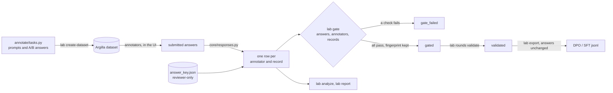
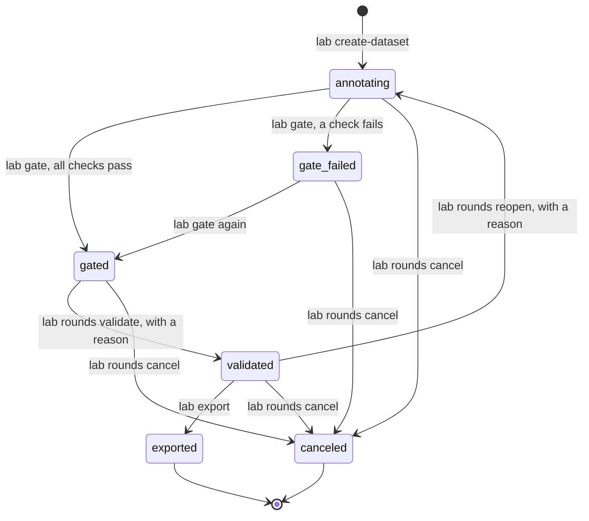
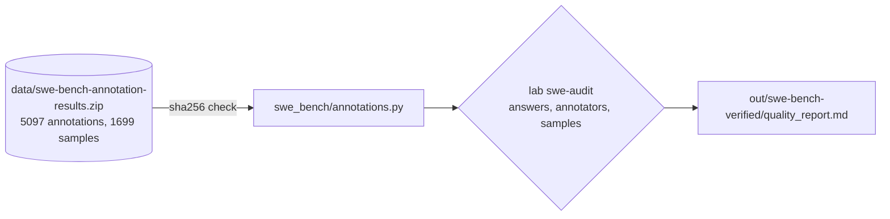

# argilla-lab

A sandbox for code-annotation quality. Annotators compare two answers to a coding prompt
in a local [Argilla](https://github.com/argilla-io/argilla), following written guidelines.
Around it: a gold key, agreement metrics, a three-layer quality gate, round statuses,
bias and calibration reports, and the export to DPO/SFT training data.

It also audits the human annotations OpenAI published with
[SWE-bench Verified](https://openai.com/index/introducing-swe-bench-verified/): the labels
are public, the checks on the labellers are not.

## Layout

```
argilla_lab/
  cli.py        one entry point: uv run lab <command>
  core/         shared building blocks, no side effects
    rubric.py     a rubric as data       checks.py     the three layers of checks, from a rubric
    report.py     Markdown quality report, sections chosen by the rubric
    responses.py  Argilla -> DataFrame   rounds.py     round status machine
    gx_runner.py  Great Expectations     agreement.py  Fleiss' kappa, Krippendorff's alpha
    config.py     .env settings          paths.py      repo paths
  rubrics/      code_preference.py, swe_verified.py
  annotate/     1. tasks and datasets in Argilla
  review/       2. accuracy, adjudication, quality report
  gate/         3. quality gate
  training/     4. DPO/SFT export, DPO training
  swe_bench/    audit of the SWE-bench Verified annotations
data/           the SWE-bench Verified annotation archive, as published
```

## How it works



The gate checks three layers, and only the votes the rubric counts make a record's decision:

| layer | question | examples of checks |
|---|---|---|
| answers | does each answer follow the guidelines? | valid labels, a rationale that names the code, tags consistent with the preference |
| annotators | can this annotator be trusted? | accuracy on the gold key, share deferred, distance to peers on a scale |
| records | is this record ready? | enough counted votes, a strict majority or a decision that does not hang on the rule |

### One gate, one report, any rubric

A rubric (`argilla_lab/rubrics/`) is data: the questions and their labels, nominal or on a scale,
the explanation each needs, which confidence counts, and how votes become a decision. The checks
and the report read the rubric and nothing else, so both rubrics run through the same code:

| | code-preference | swe-verified |
|---|---|---|
| question | preference: A, B, tie, both_bad | underspecified, false_negative 0-3; other_major_issues 0-1 |
| explanation | rationale, 20+ chars | notes, 100+ chars |
| counted votes | sure answers from annotators trusted on the gold key | every answer, there is no gold key |
| decision | the majority label | the most severe label: 2+ on a scale drops the sample |
| extra checks | issue tags match the preference | submitted at least 5 minutes after claiming |

Every round moves through statuses kept in `rounds.json`, each move logged with who and why:



The SWE-bench audit runs the same three layers on published data, no Argilla needed:



## Commands

```
uv run lab                      list the commands by stage
uv run lab create-dataset       create the round's dataset, register the round
uv run lab analyze              accuracy against the key, Fleiss' kappa
uv run lab report [ds]          decisions, agreement, annotators, calibration
uv run lab gate [ds]            three-layer quality gate
uv run lab rounds ...           list rounds, start / validate / reopen / cancel one
uv run lab export [ds]          DPO/SFT export of a validated round
uv run lab swe-audit            audit of the SWE-bench Verified annotations, no Argilla needed
```

## Setup

1. Argilla: `docker compose up -d` with
   [the compose file of the Argilla repo](https://github.com/argilla-io/argilla/tree/main/examples/deployments/docker).
2. `cp .env.example .env` and fill it.
3. `uv sync`. For `train-dpo`: `uv sync --group train`.

`LAB_PRIVATE_DIR` points to the reviewer-only folder, kept outside the repo so an annotator
cannot open it: `answer_key.json`, `adjudication.json`, `rewrites.json`, `rounds.json`.

## Data

`data/swe-bench-annotation-results.zip` is the archive OpenAI published
([source](https://cdn.openai.com/introducing-swe-bench-verified/swe-bench-annotation-results.zip)),
unchanged. `swe_bench/annotations.py` checks its sha256 before every load.
